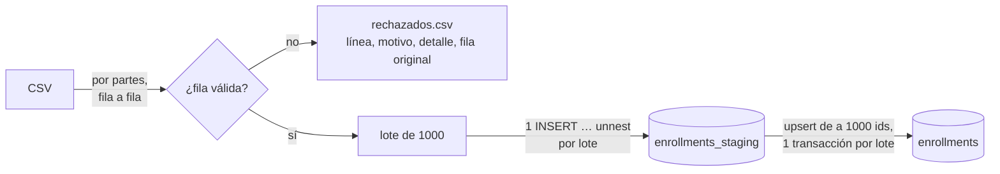

# Solución del docente: importar datos sin romperse

> Solución de referencia preparada con IA y revisada por el docente; la guía pide hacerlo sin IA a quien lo practique.

Es la versión mejorada que el docente muestra en la sesión 9 (opción A), con sus mediciones. Se compara con la ingenua de la [guía del laboratorio](../README.md), que no se modifica.

| Archivo | Qué es |
|---|---|
| [`../node/import-improved.ts`](../node/import-improved.ts) | Versión mejorada en Node 24 (solo `pg`, la dependencia que ya está en `package.json`) |
| [`../python/import_improved.py`](../python/import_improved.py) | La misma versión en Python (solo `psycopg`, la de `requirements.txt`; el CSV se lee con el módulo `csv` de la biblioteca estándar) |
| [`../sql/staging.sql`](../sql/staging.sql) | Tabla intermedia `enrollments_staging` y registro de corridas `import_runs`. No hace falta ejecutarlo a mano: los dos importadores lo ejecutan al empezar (todo es `IF NOT EXISTS`) |

Cada `CORRECCIÓN:` del código responde a un `PROBLEMA:` de la ingenua. Las dos versiones hacen lo mismo y dan las mismas cuentas; su archivo de rechazados sale **idéntico con estos archivos**.

## Cómo correrla

Con Postgres levantado y los CSV generados (pasos 1 y 2 de la guía), desde `m8/laboratorio-s09/`:

```
cd node
node import-improved.ts                                  # ../data/enrollments.csv
node import-improved.ts ../data/enrollments-500k.csv
```

```
cd python
.venv\Scripts\Activate.ps1                               # macOS, Linux o Git Bash: source .venv/bin/activate (o .venv/Scripts/activate)
python import_improved.py                                # ../data/enrollments.csv
python import_improved.py ../data/enrollments-500k.csv
```

- Un segundo argumento opcional fija el archivo de rechazados. Por omisión va a `results/rechazados-<archivo>-node.csv` o `-python.csv` (la carpeta `results/` no se sube al repositorio).
- `DATABASE_URL` funciona igual que en la ingenua. `BATCH` cambia el tamaño del lote (por omisión, 1000).
- Para vaciar la tabla entre pruebas: `docker compose exec postgres psql -U postgres -d lab -c "TRUNCATE enrollments"`.

Salida con `enrollments.csv` y la tabla vacía (Node; Python imprime lo mismo):

```
filas leídas:              50000
rechazadas:                 1484   -> ...\results\rechazados-enrollments-node.csv
  numero_de_columnas        328
  fecha_invalida            302
  monto_negativo            293
  campo_vacio               284
  correo_invalido           277
válidas:                   48516
repetidas (external_id):     501   en 496 ids; 258 con datos distintos (gana la última aparición)
ids únicos:                48015
insertadas:                48015
actualizadas:                  0
sin cambios:                   0
filas en la tabla:         48015   (external_id distintos: 48015)
cuentas:                 cierran (leídas = válidas + rechazadas; válidas = únicas + repetidas; únicas = insertadas + actualizadas + sin cambios)
resultado:               COMMIT (49 lotes a la intermedia, 49 lotes de fusión de 1000)
tiempo:                  1.53 s   (leer+validar+intermedia 0.66 s, fusión 0.87 s)
memoria máxima (RSS):    132.4 MB
```

## Cómo trabaja



1. **Leer y validar.** Lee el CSV por partes, valida cada fila y escribe las válidas en la tabla intermedia en lotes de 1000; las inválidas van al archivo de rechazados y la carga sigue.
2. **Fusionar.** Pasa de la intermedia a la final de a 1000 `external_id`, en orden, con un `upsert` idempotente; cada lote es una transacción.
3. **Cerrar.** Borra la intermedia de la corrida, anota las cuentas en `import_runs` e imprime el resumen.

## Antes y después

Máquina: Intel Core i9-12900H, 64 GB de RAM, Windows 11 Home (10.0.26200), Docker Desktop 4.99.0 (WSL2, motor 29.9.3; la máquina virtual ve 20 CPU y 31 GB), Postgres 17.11 en contenedor. Node 24.19.0 con `pg` 8.23.1 y Python 3.14.6 con `psycopg` 3.3.6, **los dos ejecutados en Windows** (fuera de Docker), contra `127.0.0.1:18450`. Medido el 9 de noviembre de 2026.

Cómo se midió:

- **Tiempo:** el que imprime cada programa (`performance.now()` / `time.perf_counter()`), desde antes de conectarse hasta el último `COMMIT`.
- **Memoria:** el pico de RSS que imprime cada programa (`process.resourceUsage().maxRSS` / `peak_rss_mb()`).
- **Corridas:** la ingenua, **1 corrida** por caso (las cuatro de la guía, en orden; con el archivo limpio tarda casi un minuto). La mejorada, **3 corridas** por caso con la tabla vaciada antes de cada una; se da la **mediana** y, entre paréntesis, el rango. Cada corrida fue seguida de su segunda ejecución sin vaciar la tabla.

Archivo de 50 000 filas, salvo donde se indica.

| Medida | Ingenua, Node | Mejorada, Node | Ingenua, Python | Mejorada, Python |
|---|---:|---:|---:|---:|
| Tiempo con `enrollments.csv` | 0,09 s, falla en la línea 43 | **1,53 s** (1,46–1,57) | 0,11 s, falla en la línea 43 | **2,21 s** (1,91–2,24) |
| Tiempo con el archivo limpio | 67,33 s | **1,55 s** (1,42–1,65) | 51,41 s | **1,97 s** (1,89–2,13) |
| Memoria máxima, 50 000 filas (`enrollments.csv`) | 100,1 MB | 132 MB (132,0–132,8) | 75,7 MB | **47,7 MB** (47,7–47,8) |
| Memoria máxima, 500 000 filas | 385,2 MB (falla en la primera fila) | 228 MB (227,7–229,9) | 413,4 MB (falla en la primera fila) | **47,6 MB** (47,6–47,6) |
| Tiempo con 500 000 filas | no carga | **14,30 s** (13,96–14,77) | no carga | **26,54 s** (26,02–28,41) |
| Filas cargadas (insertadas / actualizadas) | 0 (todo se deshace) | **48 015 / 0** | 0 | **48 015 / 0** |
| Filas rechazadas (total) | ninguna registrada | **1484**, con línea y motivo | ninguna registrada | **1484** |
| Filas repetidas encontradas | ninguna informada | **501** (en 496 ids; 258 con datos distintos) | ninguna informada | **501** |
| Segunda ejecución: insertadas / actualizadas | falla: `duplicate key` (archivo limpio) | **0 / 0** (3 de 3) | falla: `duplicate key` | **0 / 0** (3 de 3) |
| Segunda ejecución: tiempo | 0,08 s, falla | 1,37 s (1,24–1,64) | 0,07 s, falla | 1,73 s (1,69–2,11) |
| Segunda ejecución: ¿la base quedó igual? | sí, porque no hizo nada | **sí** (3 de 3) | sí, porque no hizo nada | **sí** (3 de 3) |
| Filas en la tabla al final (`count(*)` / `count(DISTINCT external_id)`) | 0 / 0 | 48 015 / 48 015 | 0 / 0 | 48 015 / 48 015 |

Con 500 000 filas, la mejorada carga **480 204** ids únicos, rechaza **14 915** (fecha 3006, correo 2872, monto negativo 3050, campo vacío 2969, columnas 3018) y encuentra **4881** repetidas: exactamente el resumen del generador. Su segunda ejecución también da 0 / 0 (3 de 3; Node 12,95 s, Python 23,57 s).

«¿La base quedó igual?» se comprobó antes y después de cada segunda ejecución con:

```sql
SELECT count(*), count(DISTINCT external_id), max(updated_at),
       md5(string_agg(concat_ws('|', external_id, student_name, email, course_code, enrolled_on, amount, updated_at),
                      ',' ORDER BY external_id))
  FROM enrollments;
```

Los cuatro valores (también la huella `md5`, que incluye `updated_at` de cada fila) salieron iguales en las 18 segundas ejecuciones.

**Qué muestran las cifras:**

- **Tiempo.** Con el archivo limpio, de 67 s a 1,5 s en Node y de 51 s a 2 s en Python: de 50 000 viajes a la base (uno por fila) a unos 100 (un `INSERT` por lote de 1000 a la intermedia y un `upsert` por lote de 1000 ids). Ojo: aquí la ingenua de Python fue **más rápida** que la de Node, al revés que en la referencia de la guía, porque aquí Python corrió en Windows igual que Node (en la guía corrió dentro de un contenedor, con más latencia por fila). Por eso se mide todo en las mismas condiciones.
- **Memoria en Python:** 47,7 MB con 50 000 filas y 47,6 MB con 500 000. Diez veces más archivo, la misma memoria: lee por partes. La ingenua pasa de 76 a 413 MB.
- **Memoria en Node:** el pico **sube** de 132 a 228 MB, aunque lee por partes. No es memoria que se quede viva: V8 deja crecer el *heap* mientras le sobra espacio y recolecta más tarde. La prueba es correr con el *heap* limitado a 32 MB:

  | 500 000 filas, `node --max-old-space-size=32` | Resultado |
  |---|---|
  | `import-naive.ts` | **muere**: `FATAL ERROR: Reached heap limit Allocation failed - JavaScript heap out of memory` |
  | `import-improved.ts` | **termina**: 480 204 insertadas, 12,50 s, RSS 182 MB |

  Un pico que sube no prueba que la memoria crezca con el archivo; correr con un límite bajo, sí.

### Rechazadas por motivo

`enrollments.csv`. Las cifras coinciden con las del generador; el ejemplo es la primera fila de cada motivo en el archivo de rechazados.

| Motivo | Filas | Generador | Ejemplo (línea y valor) |
|---|---:|---:|---|
| `numero_de_columnas` | 328 | columnas de más: 328 | línea 144: `Quispe Flores, Pablo` (una coma en el nombre): «se esperaban 6 columnas y hay 7» |
| `fecha_invalida` | 302 | fecha mal escrita: 302 | línea 43: `26/08/2026` (la misma donde se cae la ingenua) |
| `monto_negativo` | 293 | monto negativo: 293 | línea 200: `-374.00` |
| `campo_vacio` | 284 | campo vacío: 284 | línea 510: «student_name vacío» |
| `correo_invalido` | 277 | correo inválido: 277 | línea 125: `ana.salazar38.example.edu` |
| **Total** | **1484** | **1484** | |

El archivo de rechazados tiene las columnas `linea,motivo,detalle,fila_original`: se puede abrir en una planilla, corregir y volver a cargar. Para ver los primeros de cada motivo: `Select-String fecha_invalida ..\results\rechazados-enrollments-node.csv | Select -First 3` (PowerShell) o `grep -m3 fecha_invalida ../results/rechazados-enrollments-node.csv`.

### Caída a la mitad

El proceso se mató a la fuerza (`taskkill /F`, más brusco que Ctrl+C) con el archivo de 500 000 filas, se relanzó con el mismo archivo y se comparó la tabla final con la de una corrida sin cortes (huella `md5` del contenido, sin `updated_at`):

| Corte | Estado tras el corte | Al relanzar | ¿Igual que sin corte? |
|---|---|---|---|
| Node, a los 3 s (leyendo) | final: 0 filas; intermedia: 439 000 filas huérfanas; corrida sin terminar en `import_runs` | 480 204 insertadas | **sí** |
| Node, a los 9 s (fusionando) | final: 46 000 filas (46 lotes ya confirmados) | 434 204 insertadas, 46 000 sin cambios | **sí** |
| Python, a los 22 s (fusionando) | final: 240 000 filas | 240 204 insertadas, 240 000 sin cambios | **sí** |

## Decisiones

- **Lectura por partes.** Node: `createReadStream` de a 64 KB y `for await`, que da contrapresión (mientras se escribe un lote no se lee más). Python: `csv.reader` sobre el archivo abierto, una fila por iteración. En memoria hay un trozo del archivo y un lote de 1000 filas.
- **Lector de CSV.** Python usa el módulo `csv` de la biblioteca estándar (`newline=""` y `encoding="utf-8-sig"` para quitar el BOM de Excel). En Node no se agregó una dependencia (`csv-parse`): el lector propio cubre lo que el RFC 4180 permite (comas y comillas dobladas `""` dentro de comillas, y saltos de línea dentro de un campo) y para las filas sin comillas, que son casi todas, usa `split(',')`. Alcanza para este archivo. Si el CSV viniera de muchas fuentes distintas, conviene una biblioteca probada, con su versión fijada.
- **Encabezado.** Se compara con el esperado antes de cargar nada. Si cambió el orden de las columnas, la carga se detiene en vez de rechazar 50 000 filas.
- **Validación, en el programa y antes de la base.** Número de columnas exacto (las de más **no** se cortan: se rechaza la fila), obligatorios no vacíos, `external_id` con formato `INS-0000000`, correo y código de curso con las mismas expresiones que los `CHECK` de la tabla, fecha `AAAA-MM-DD` que exista (`2026-02-30` no), monto numérico con hasta dos decimales, no negativo y dentro de `numeric(10,2)`. No se deja a la base porque Postgres acepta `2026/03/05` y lee `05/03/2026` como 3 de mayo. Cada rechazo lleva un **motivo** corto (para contar) y un **detalle** legible (para corregir), con la **línea donde empieza la fila**.
- **Repetidas: gana la última aparición del archivo.** En este archivo la repetición con otro monto es una «corrección», y la última línea es la más reciente. La deduplicación (`DISTINCT ON (external_id) … ORDER BY external_id, line DESC`) se hace sobre **toda la corrida** en la intermedia, no por lote de lectura: si se hiciera por lote, una repetida en otro lote haría que la segunda ejecución «corrigiera y descorrigiera» la fila y ya no daría 0 actualizadas. Frente a la base: si los datos son iguales, la fila no se toca; si cambiaron, se actualiza.
- **Carga.** A la intermedia, un `INSERT … SELECT … FROM unnest(arreglos)` por lote de 1000: un viaje por lote. De la intermedia a la final:

  ```sql
  INSERT INTO enrollments AS e (...) SELECT ... FROM src          -- src: 1000 ids, la última línea de cada uno
  ON CONFLICT (external_id) DO UPDATE
     SET student_name = EXCLUDED.student_name, ..., updated_at = now()
   WHERE (e.student_name, e.email, e.course_code, e.enrolled_on, e.amount)
         IS DISTINCT FROM (EXCLUDED.student_name, EXCLUDED.email, EXCLUDED.course_code, EXCLUDED.enrolled_on, EXCLUDED.amount)
  RETURNING (xmax = 0) AS ins                                       -- true = insertada, false = actualizada
  ```

  El `WHERE … IS DISTINCT FROM` es lo que hace que la segunda ejecución dé 0 actualizadas y no mueva `updated_at`. `xmax = 0` es un truco conocido de Postgres para distinguir insertadas de actualizadas, pero no está documentado como contrato.
- **Un detalle que se notó al medir: `ANALYZE`.** La intermedia se llena y se lee enseguida, antes de que Postgres tenga estadísticas de ella. Sin `ANALYZE`, cada lote de la fusión ordenaba **todas** las filas restantes (29 ms por lote con 48 000 filas, y crece con el archivo); con `ANALYZE` recorre el índice y se detiene a las 1000 (0,4 ms). Con 50 000 filas son 49 lotes: unos 49 × 29 ms ≈ 1,4 s de más en la fusión (que con `ANALYZE` tarda ≈ 0,9 s).
- **Transacciones: una por lote**, en las dos fases. Una fila mala no puede abortar nada, porque no llega a la base. Si el proceso cae **leyendo**, la final no cambió; la intermedia de esa corrida se descarta al relanzar. Si cae **fusionando**, la final queda con algunos lotes ya confirmados, cada uno con su valor definitivo; relanzar completa lo que faltaba y deja exactamente lo mismo (ver «Caída a la mitad»). Si la final tuviera que cambiar «toda o nada», la fusión iría en una sola transacción al final, a cambio de bloquear filas más tiempo.
- **Una sola carga a la vez.** `pg_try_advisory_lock` al empezar: si otra carga está en curso, sale con un mensaje. Con el candado tomado, lo que haya en la intermedia es de una corrida caída, y se borra.
- **Las cuentas tienen que cerrar.** El resumen las comprueba: leídas = válidas + rechazadas; válidas = únicas + repetidas; únicas = insertadas + actualizadas + sin cambios.

## Qué no se midió o no se resolvió

- Tiempos medidos con el importador en Windows y Postgres en Docker (WSL2): el camino de red pesa, sobre todo en la ingenua (un viaje por fila). Dentro de la red de Compose los dos lados serían más rápidos.
- Ctrl+C desde la consola no se probó en la medición: se probó `taskkill /F`, que es más brusco (ni siquiera deja cerrar la conexión).
- Con comillas solo se probó un CSV pequeño hecho a mano (37 filas: una coma y un salto de línea dentro de comillas, y dos comillas sin cerrar, una a mitad del archivo y otra cerca del final): Node y Python rechazan solo las 2 líneas con la comilla suelta (`comilla_sin_cerrar`), cargan las 35 válidas y las cuentas cierran. Si una comilla no se cierra en 20 líneas (o antes del final del archivo), se rechaza solo la línea donde se abrió y las siguientes se vuelven a leer. No se probaron dos cargas a la vez más allá del candado.
- Python lee y valida unas 3 veces más lento que Node con 500 000 filas (18 s frente a 6 s en esa fase); no se perfiló.

## Guion de la demostración en vivo (≈ 25 min)

**Antes de la clase (no cuenta en los 25 min).** Todo desde `m8/laboratorio-s09/` en PowerShell, con dos terminales: una en `node/` y otra en `python/` con el entorno virtual activado.

```
docker version                                   # Client y Server
docker compose up -d --wait
docker compose exec postgres psql -U postgres -d lab -c "TRUNCATE enrollments"
dir data                                         # enrollments.csv, enrollments-clean.csv, enrollments-500k.csv
```

- Si faltan los CSV: en `node/`, `node generate.ts`, `node generate.ts --clean` y `node generate.ts --rows 500000 --out ../data/enrollments-500k.csv`. Si falta `node_modules`: `npm ci`. Si falta el entorno de Python: `python -m venv .venv` y `.venv\Scripts\python -m pip install -r requirements.txt`.
- Docker Desktop se actualizó solo durante la medición (motor 29.9.2 → 29.9.3, Docker Desktop 4.99.0) y detuvo el contenedor. Antes de la clase, abran Docker Desktop y acepten o pospongan cualquier actualización pendiente.
- Abran en el editor `import-naive.ts` e `import-improved.ts` lado a lado.

**1. Qué se va a ver (3 min).** Mostrar las primeras líneas del CSV (`Get-Content ..\data\enrollments.csv -TotalCount 3`) y el resumen del generador (1484 inválidas de cinco tipos, 501 repetidas). Decir: «vamos a medir tiempo, memoria, filas cargadas, rechazadas, repetidas y qué pasa la segunda vez».

**2. La ingenua (5 min).** En `node/`:

```
node import-naive.ts
```

Falla en la línea 43 (`26/08/2026`), **0 filas**: deshizo también las 41 buenas, y no dice nada de las otras 1483. Recorrer los `PROBLEMA:` del código. Después:

```
node import-naive.ts ../data/enrollments-clean.csv
```

Tarda ≈ 1 minuto (67 s medido): mientras corre, explicar «50 000 viajes a la base». Luego, otra vez el mismo comando: `duplicate key`. Volver a ejecutar **falla**, y sin la clave única habría duplicado todo. La corrida de 500 000 (385 MB) se cuenta con la cifra de la tabla, o se corre si sobra tiempo (no tarda: falla en la primera fila).

**3. La mejorada, en el código (6 min).** Recorrer `import-improved.ts` de arriba abajo, cada `CORRECCIÓN:` frente a su `PROBLEMA:`: `physicalLines` y `readCsv` (por partes; comillas), `validate` (motivo + detalle; las fechas con barras que Postgres aceptaría), `stageBatch` (un `INSERT` por lote), `MERGE` (`DISTINCT ON` = gana la última, `ON CONFLICT`, `IS DISTINCT FROM`), y la fase 2 con una transacción por lote.

**4. La mejorada, corriendo (8 min).**

```
docker compose exec postgres psql -U postgres -d lab -c "TRUNCATE enrollments"
node import-improved.ts
```

≈ 1,5 s, 48 015 insertadas, 1484 rechazadas por motivo: comparar con el resumen del generador. Abrir el archivo de rechazados (`..\results\rechazados-enrollments-node.csv`) y mostrar la línea 43.

Segunda ejecución:

```
docker compose exec postgres psql -U postgres -d lab -c "SELECT count(*), count(DISTINCT external_id), max(updated_at) FROM enrollments"
node import-improved.ts
docker compose exec postgres psql -U postgres -d lab -c "SELECT count(*), count(DISTINCT external_id), max(updated_at) FROM enrollments"
```

**0 insertadas, 0 actualizadas**, y las dos consultas dan lo mismo.

Una corrección real (el archivo «del mes siguiente» con un solo monto cambiado):

```
node -e "const fs=require('fs'); const t=fs.readFileSync('../data/enrollments.csv','utf8'); fs.writeFileSync('../data/enrollments-fix.csv', t.replace('GES-160,2026-01-10,305.00','GES-160,2026-01-10,310.00'))"
node import-improved.ts ../data/enrollments-fix.csv
```

**1 actualizada**, 48 014 sin cambios. Mostrarla: `docker compose exec postgres psql -U postgres -d lab -c "SELECT external_id, amount, created_at, updated_at FROM enrollments WHERE updated_at > created_at"`.

Memoria con 500 000 filas, en la terminal de Python:

```
python import_improved.py
docker compose exec postgres psql -U postgres -d lab -c "TRUNCATE enrollments"
python import_improved.py ../data/enrollments-500k.csv
```

La primera tarda ≈ 2 s y **deshace la corrección** (vuelve a leer `enrollments.csv`, con el monto original: 1 actualizada, 48 014 sin cambios). Se vacía la tabla para que la de 500 000 dé las cuentas de la tabla de arriba (480 204 insertadas); tarda ≈ 25–30 s. Memoria: ≈ 48 MB las dos: diez veces más archivo, la misma memoria. Si sobra tiempo, en Node: `node --max-old-space-size=32 import-naive.ts ../data/enrollments-500k.csv` muere y `node --max-old-space-size=32 import-improved.ts ../data/enrollments-500k.csv` termina.

*(Opcional, 2 min)* Caída a la mitad, en `node/`:

```
docker compose exec postgres psql -U postgres -d lab -c "TRUNCATE enrollments"
node import-improved.ts ../data/enrollments-500k.csv
```

Con 500 000 filas tarda unos segundos (entre 15 y 45 s según la carga del equipo). Cuando aparezca «fase 2: fusionando…», esperar unos 2 s y pulsar Ctrl+C. Relanzar el mismo comando: sale parte «insertadas», parte «sin cambios» (en la prueba previa, 400 204 y 80 000), y la tabla queda igual que sin el corte (480 204 filas).

**5. Cierre (3 min).** La tabla «Antes y después» de esta página, y preguntas. La idea para llevarse: cuando una IA escriba la próxima carga, revisen qué pasa con la primera fila mala y con la segunda ejecución.
